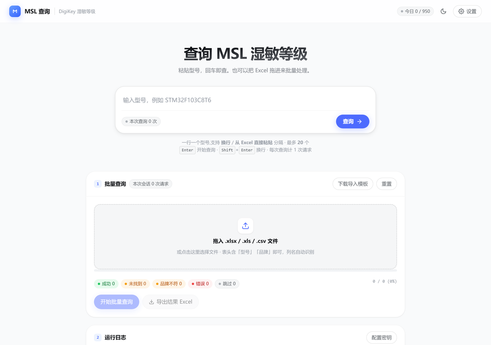
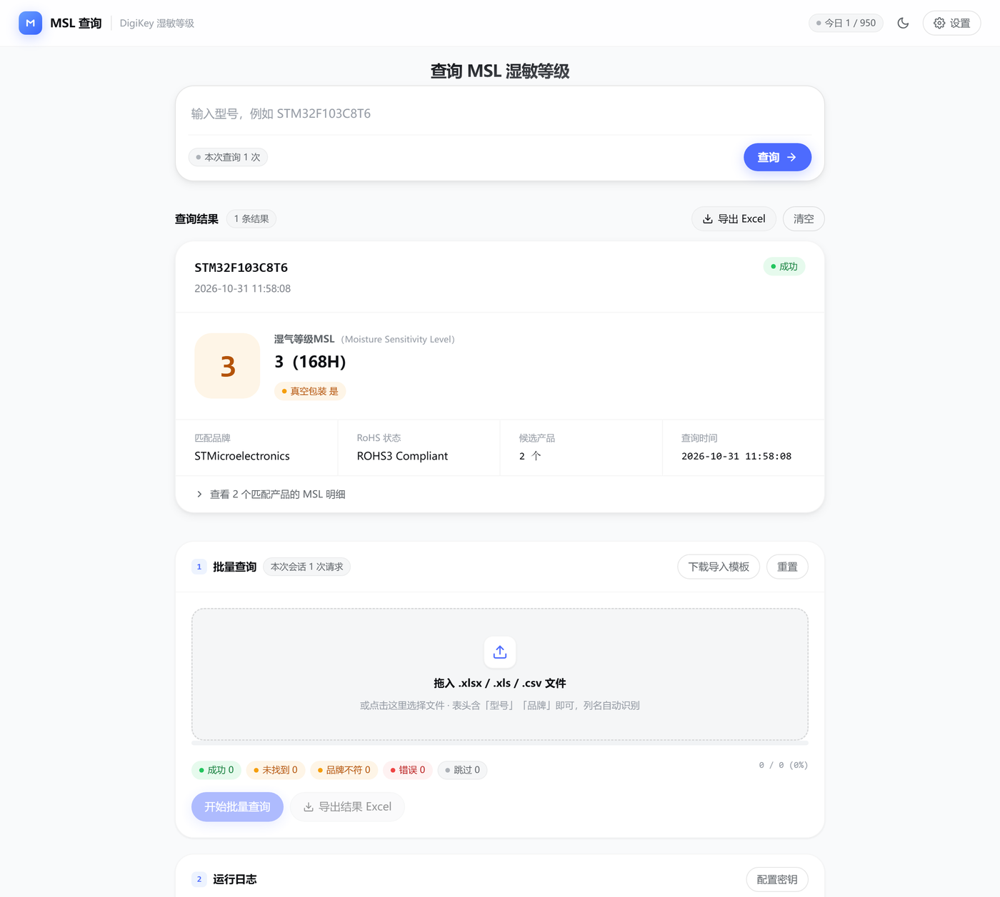
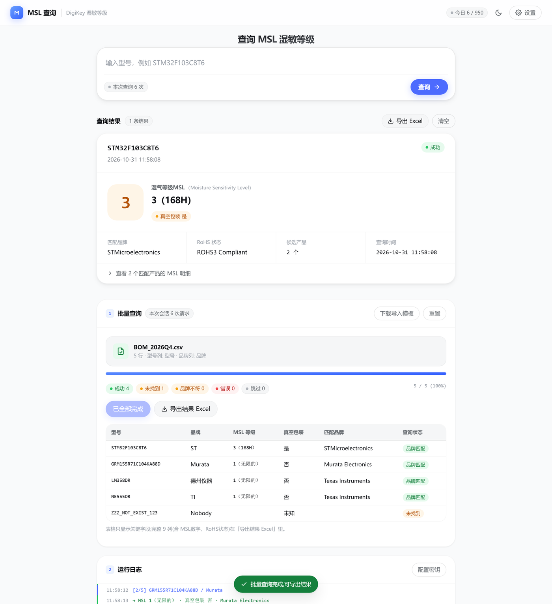
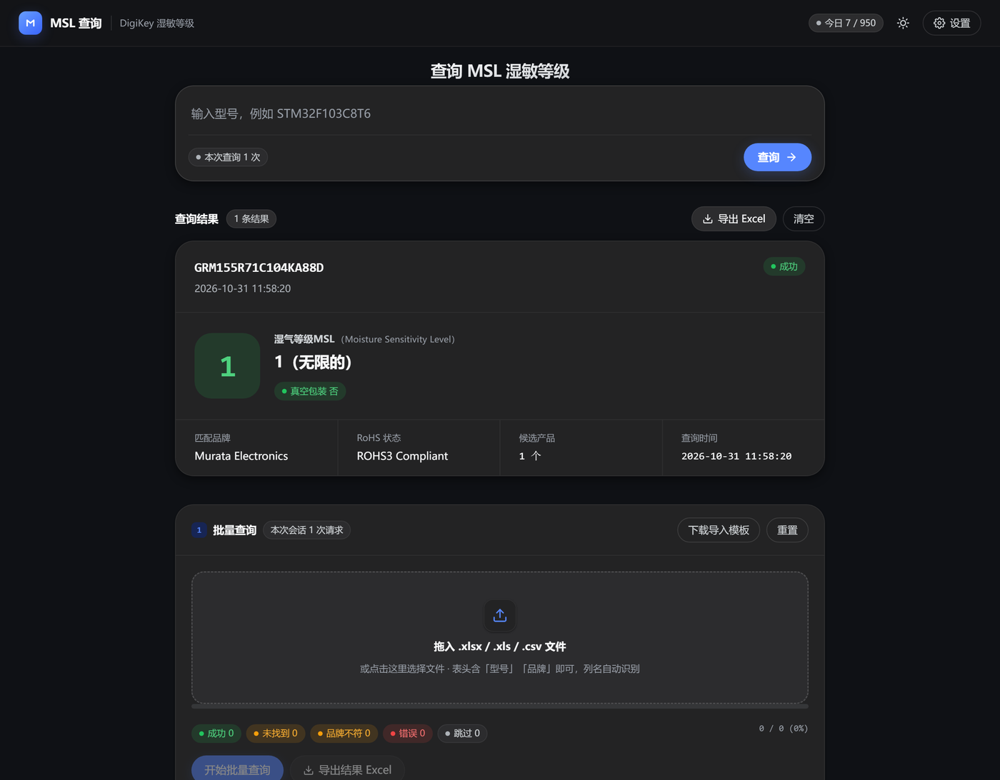

# DigiKey MSL 查询

> 一个纯前端的 DigiKey 湿敏等级（MSL）批量查询工具。浏览器直接调用 DigiKey 官方 API，无需后端服务，密钥只存放在你自己的浏览器里。

**在线使用 → <https://vh5744690-eng.github.io/digikey-msl-query/>**

填入自己的 DigiKey 密钥即可使用，无需安装任何东西。密钥只保存在本机浏览器，不会上传到任何服务器。



---

## 简介

采购与硬件工程师在确认物料能否过回流焊时，需要知道每颗器件的 **MSL（Moisture Sensitivity Level，湿敏等级）**，以及它是否必须真空包装。这些信息散落在 DigiKey 的商品页里，做一个 BOM 就要翻几十个页面。

DigiKey 提供了官方的商品查询 API，但调用它需要 OAuth2 认证、解析嵌套 JSON、把 `MoistureSensitivityLevel` 字段从分类信息里挖出来，还要处理品牌匹配等细节。本项目把这些工作包成一个网页：粘贴型号或导入 Excel，直接拿到结构化的 MSL 结果。

---

## 解决的问题

| 痛点 | 本工具的解法 |
|---|---|
| 手动逐个查 DigiKey，一个 BOM 要开几十个标签页 | 一次粘贴最多 20 个型号，或直接导入 Excel 批量跑 |
| MSL 藏在 `Classifications.MoistureSensitivityLevel` 里，还带英文括号说明（`3  (168 Hours)`） | 自动提取并转成中文等级 `3（168H）` |
| 不同供应商对同一型号的 MSL 可能不同，容易选错 | 支持按品牌精确匹配，并列出所有候选产品的 MSL 明细 |
| 判断"是否要真空包装"每次都要查规格书 | MSL ≥ 2 自动标记为"需真空包装" |
| 查询中断后要重头再来，浪费 API 配额（免费额度每天 1000 次） | 断点续查：重新导入上次结果，已查过的行自动跳过 |
| 调用 API 要写 OAuth2 + JSON 解析代码 | 打开网页填密钥即可用，无任何安装 |

---

## 核心功能

### 单型号查询
- 粘贴型号，按 <kbd>Enter</kbd> 或点「查询」即发请求，实时计数。
- 一次可查多个，**一行一个型号**，最多 **20 个**。
- 分隔符只有两种：**换行**、**制表符**（从 Excel 直接粘贴即为此格式，同列为换行、同行为制表符）。
- **不把逗号、分号、顿号、空格当作分隔符** —— 有些型号本身带这些字符，按标点切会把一个型号拆成两个，白白消耗一次配额。
- 输入时实时显示「识别到 N 个型号」，超出上限会变红并拒绝发送，不会静默截断。

### 批量查询
- 拖入 `.xlsx` / `.xls` / `.csv`，或点击选择文件。
- 表头自动识别：型号列匹配 `型号` / `MPN` / `part` / `料号`，品牌列匹配 `品牌` / `厂` / `brand` / `mfr`。
- 自动跳过文件底部的「说明：」「1. xxx」等备注行。
- 实时进度条 + 分状态统计 + 逐行运行日志。
- 断点续查：重新导入上次导出的结果，已有「查询状态」的行自动跳过。
- 进度自动保存，误关页面重开可恢复。

### 结果输出
- 结果卡：中文 MSL 等级、MSL 数字徽章（按等级变色）、是否需要真空包装、匹配品牌、RoHS 状态、候选产品明细。
- 一键导出 Excel，列固定为 9 列：

  `型号 | 品牌 | MSL等级 | MSL数字 | 需真空包装 | 匹配品牌 | RoHS状态 | 查询状态 | 查询时间`

### MSL 等级中文对照

| DigiKey 返回 | 页面展示 | 车间寿命 |
|---|---|---|
| `1 (Unlimited)` | **1（无限的）** | 无限车间寿命 |
| `2 (1 Year)` | **2（1年）** | 一年车间寿命 |
| `2a (4 Weeks)` | **2a（4周）** | 四周车间寿命 |
| `3 (168 Hours)` | **3（168H）** | 168 小时车间寿命 |
| `4 (72 Hours)` | **4（72H）** | 72 小时车间寿命 |
| `5 (48 Hours)` | **5（48H）** | 48 小时车间寿命 |
| `5a (24 Hours)` | **5a（24H）** | 24 小时车间寿命 |
| `6 (12 Hours)` | **6（12H）** | 12 小时车间寿命 |

非数值型返回值同样处理：`Not Applicable` → **不适用**，`Vendor Undefined` → **厂商未定义**，未识别的值原样显示。

### 其他
- 深色 / 浅色主题，默认跟随系统。
- 响应式布局，手机可用。
- 键盘快捷键：<kbd>Enter</kbd> 查询、<kbd>Shift</kbd>+<kbd>Enter</kbd> 换行、<kbd>Ctrl</kbd>+<kbd>,</kbd> 打开设置。
- 内置导入模板下载。

<details>
<summary>更多截图</summary>

**单型号查询结果**



**批量查询**



**深色模式**



</details>

---

## 技术栈

| 层 | 选型 | 说明 |
|---|---|---|
| 运行环境 | 浏览器（原生 ES5 语法，无构建） | 双击 `index.html` 即可运行，也可托管为静态站 |
| 语言 | 原生 JavaScript / HTML / CSS | 零框架、零依赖、零编译 |
| 网络 | Fetch API + `URLSearchParams` | 表单编码取 token，属 CORS 简单请求，不触发预检 |
| 认证 | OAuth2 Client Credentials | Token 缓存在内存，剩余 60 秒时自动续期 |
| Excel 解析 | [SheetJS](https://sheetjs.com/) `xlsx.full.min.js` | 已本地化到仓库，不依赖 CDN |
| 持久化 | `localStorage` | 存密钥、设置、计数、批量进度 |
| 样式 | 原生 CSS + CSS 变量 | 设计 token 取自 DeepSeek 官网 |
| 部署 | GitHub Pages（静态托管） | 无服务端 |

### 为什么不需要后端

DigiKey 的 OAuth 与搜索端点都返回了 CORS 响应头（`Access-Control-Allow-Origin` 回显请求 Origin，且允许 `authorization` / `x-digikey-client-id` 等请求头），因此浏览器可以直接调用，无需反向代理。

这意味着使用者只需要填自己的密钥，不需要信任任何第三方服务器 —— 也就不存在"密钥要部署在哪"的问题。

---

## 使用方法

### 1. 申请自己的 DigiKey 密钥（免费）

1. 打开 <https://developer.digikey.com/>，用 DigiKey 账号登录。
2. 进入 **My Applications**，点 **Create Application**。
   - 名称任意，例如 `MSL 查询`。
   - 用的是 2-legged OAuth（Client Credentials），**不需要填 Redirect URI**。
3. 到 **API Products / Subscriptions**，订阅 **Product Information API v4**。
   > 这一步容易漏。未订阅时搜索接口会返回 401 / 403。
4. 回到应用详情页，复制 **Client ID** 与 **Client Secret**（Secret 只显示一次，丢失只能重新生成）。

免费额度：每个 Client ID 每日 **1000 次**。

参考资料：[DigiKey API 文档](https://developer.digikey.com/documentation) · [2-Legged OAuth 教程](https://developer.digikey.com/tutorials-and-resources/oauth-20-2-legged-flow)

### 2. 打开工具

**方式一：直接访问在线版（最省事）**

<https://vh5744690-eng.github.io/digikey-msl-query/>

**方式二：本地双击**

下载仓库后双击 `docs/index.html`。首次打开会自动弹出设置窗。

**方式三：本地起静态服务**

```bash
python -m http.server 8811 --directory docs
```

然后访问 <http://127.0.0.1:8811/>

> `file://` 模式可用，但部分浏览器的 `localStorage` 按文件路径隔离，换目录后密钥需重填。

### 3. 配置并使用

1. 点右上角「设置」，填入 Client ID 与 Client Secret。
2. 点「测试连接」，显示「连接成功」后保存。
3. 回到首页：粘贴型号回车，或把 Excel 拖进「批量查询」区域。
4. 批量查询完成后点「导出结果 Excel」。

### 4. 部署到自己的 GitHub Pages（可选）

1. 把仓库 **Settings → Pages** 打开。
2. **Source** 选 `Deploy from a branch`，Branch 选 `main`，Folder 选 **`/docs`**，保存。
3. 等 1~2 分钟，访问 `https://<你的用户名>.github.io/<仓库名>/`。

因为站点就在 `docs/` 目录，无需任何构建步骤。

---

## 注意事项

1. **密钥保存在浏览器 `localStorage` 中。**
   这是纯前端 + 自备密钥（BYOK）模式的必然取舍。密钥不会上传到任何服务器，但同一台电脑上的其他程序可以读取。请勿在公共电脑上填写，也请勿把仓库用于存放任何人的密钥。

2. **页面上的用量是"本机计数"，不是服务端余额。**
   DigiKey 的响应头里有 `x-ratelimit-remaining`，但没有返回 `Access-Control-Expose-Headers`，浏览器 JS 读不到它（实测仅 `content-length`、`content-type` 可读）。因此界面显示的是本机累计次数，多设备使用同一 Client ID 时各设备互不相通，请自行留余量。

3. **依赖 DigiKey 持续开放 CORS。**
   目前开放，但官方未作承诺。若未来关闭，页面会提示「网络错误或跨域被拒」。

4. **`localStorage` 按 Origin 隔离。**
   换域名、换浏览器、清除浏览器数据后，密钥与计数都需要重来。

---

## 目录结构

```
docs/                    ← 整个站点，GitHub Pages 的发布目录
├── index.html           页面结构
├── assets/
│   ├── styles.css       样式与设计 token
│   ├── digikey.js       API 客户端、MSL 提取与品牌匹配（核心逻辑）
│   └── app.js           界面交互、批量导入与导出
├── vendor/
│   └── xlsx.full.min.js SheetJS（已本地化，不依赖 CDN）
├── screenshot/          文档用截图
└── .nojekyll            让 GitHub Pages 跳过 Jekyll
```

## 许可

[MIT](LICENSE)

---

数据来源 [DigiKey](https://www.digikey.com/)。本项目与 DigiKey 官方无隶属关系。
